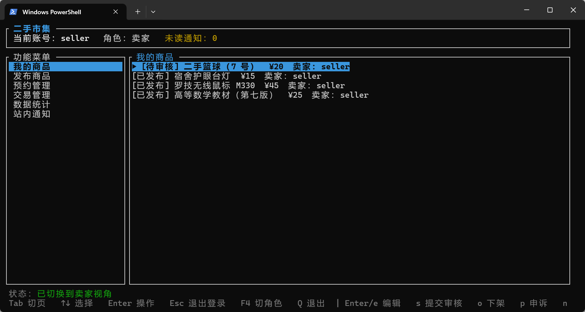

# 二手市集

> 本项目为软件工程课程实验项目。

一个在终端里运行的校园二手交易平台：买家浏览与预约、卖家发布与成交、管理员审核与治理，全部操作通过 TUI 完成，数据保存在本地 JSON 文件中。



## 基本功能

**买家**：浏览已发布商品、发起预约、取消预约、查看本人预约与交易、确认交易、查看站内通知。

**卖家**：发布商品、编辑商品、主动下架、确认预约、标记交易完成、查看数据统计、处理违规申诉。

**平台管理员**：商品审核、违规下架、处理申诉、封禁与解封用户、解锁登录、查询操作日志与平台统计。

**通用**：

- 注册与登录
- JSON 文件全量持久化

## 快速开始

### 环境要求

- Rust 1.88 或更高版本
- 一个支持 ANSI 转义序列的终端

### 构建

```bash
git clone https://github.com/zhley/SE_Lab.git
cd SE_Lab

cargo build
```

### 运行

```bash
cargo run
```

首次启动会自动创建 `data/store.json`，并写入演示账号、分类和商品；删除 `data/` 目录即可恢复初始状态。

### 测试

```bash
cargo test
```

## 相关文档

- 需求文档：`requirements/requirements.md`
- 设计图：`UML/*.puml`

---
